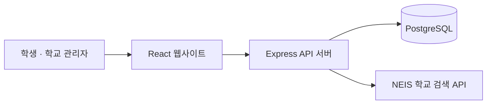

# 모아 · 수행평가 통합 일정표

> **수행평가 일정을 한곳에서 확인하고, 함께 정확하게 관리하는 학교 일정 서비스**

모아는 학교·학년·반별 수행평가 일정을 달력에서 확인하고, 학생이 일정 등록이나 수정 사항을 제안하면 학교 관리자가 검토할 수 있도록 돕는 웹 서비스입니다. 학생에게는 한눈에 파악하기 쉬운 일정표를, 학교에는 함께 관리할 수 있는 절차를 제공합니다.

<p align="center">
  <a href="https://jinn-0901.github.io/assessment-calendar-web/"><strong>모아 웹사이트 열기 →</strong></a>
  &nbsp; · &nbsp;
  <a href="https://github.com/jinn-0901/assessment-calendar-server">백엔드 저장소</a>
</p>

---

## 한눈에 보기

| 구분 | 내용 |
| --- | --- |
| 서비스 | [모아 수행평가 통합 일정표](https://jinn-0901.github.io/assessment-calendar-web/) |
| 프런트엔드 | [GitHub 저장소](https://github.com/jinn-0901/assessment-calendar-web) |
| 백엔드 API | [assessment-calendar-server.onrender.com](https://assessment-calendar-server.onrender.com) |
| API 상태 확인 | [`/api/health`](https://assessment-calendar-server.onrender.com/api/health) |
| 주요 기술 | React 18 · Create React App · CSS |

## 어떤 일을 할 수 있나요?

- **일정 확인:** 학교와 학년·반을 기준으로 수행평가 일정을 확인합니다.
- **달력으로 파악:** 여러 날짜에 걸친 일정과 과목별 일정을 달력에서 살펴봅니다.
- **학생의 참여:** 로그인 없이 일정 등록 및 수정 신청을 제출할 수 있습니다.
- **관리자의 검토:** 학교 관리자가 신청을 승인하거나 반려합니다.
- **학교 정보 관리:** 학교·학급·과목 정보를 등록하고 관리합니다.
- **편안한 사용 경험:** 모바일·태블릿 화면과 다크 모드를 지원합니다.
- **학교 검색:** NEIS 교육정보 개방 API를 이용해 학교를 검색합니다.

### 일정은 어떻게 공개되나요?

학생이 제출한 등록·수정 신청은 **관리자 승인 전까지 공개 일정에 반영되지 않습니다.** 관리자가 직접 등록한 일정은 즉시 공개됩니다. 따라서 신청과 공개된 일정을 구분해 운영할 수 있습니다.

## 서비스 구조



- **프런트엔드:** 화면, 달력, 사용자 입력 및 API 요청을 담당합니다.
- **백엔드:** 일정과 신청 처리, 관리자 인증, 학교 검색 연동을 담당합니다.
- **데이터베이스:** 학교·학급·과목·일정과 관련 정보를 저장합니다.

## 기술 스택

| 영역 | 기술 |
| --- | --- |
| UI | React 18 |
| 개발·빌드 | Create React App (`react-scripts`) |
| 스타일 | CSS |
| API | Node.js · Express |
| 데이터 저장 | PostgreSQL |
| 학교 검색 | NEIS 교육정보 개방 API |

## 로컬에서 실행하기

### 준비물

- Node.js 18 이상
- Git
- 실행 중인 모아 백엔드 API

### 1. 저장소 내려받기

```bash
git clone https://github.com/jinn-0901/assessment-calendar-web.git
cd assessment-calendar-web
npm install
```

### 2. API 서버 주소 설정하기

프로젝트 루트에 `.env.local` 파일을 만들고 백엔드 주소를 설정합니다.

```dotenv
REACT_APP_API_BASE_URL=https://assessment-calendar-server.onrender.com
```

주소 끝에는 슬래시(`/`)를 붙이지 마세요. 로컬 백엔드를 사용하는 경우 해당 로컬 주소로 바꾸면 됩니다. 프런트엔드에서 사용하는 변수는 `REACT_APP_API_BASE_URL`입니다.

### 3. 개발 서버 실행

```bash
npm start
```

기본 주소는 [http://localhost:3000](http://localhost:3000)입니다.

### 4. 배포용 빌드 만들기

```bash
npm run build
```

빌드 결과물은 `build/` 디렉터리에 생성됩니다. 이 저장소의 배포 주소는 GitHub Pages이며, 실제 배포 과정은 저장소의 GitHub Pages 및 Actions 설정을 기준으로 합니다.

## 프로젝트 구조

```text
public/
└── index.html
src/
├── index.js
├── App.js
├── styles.css
├── components/
│   ├── common/
│   │   ├── Modal.jsx
│   │   ├── Field.jsx
│   │   └── EmptyState.jsx
│   ├── assessments/
│   │   └── AssessmentModal.jsx
│   └── setup/
│       └── SetupModal.jsx
└── lib/
    ├── api.js
    └── date.js
```

| 경로 | 역할 |
| --- | --- |
| `src/App.js` | 주요 화면과 앱 흐름 |
| `src/styles.css` | 전역 스타일 및 반응형 화면 |
| `src/components/` | 화면에서 재사용하는 UI 구성 요소 |
| `src/lib/api.js` | 백엔드 API 요청과 응답 처리 |
| `src/lib/date.js` | 날짜 처리 관련 유틸리티 |
| `public/index.html` | HTML 진입점 |

## API 연동과 문제 해결

- **화면은 열리지만 일정이 보이지 않아요.** 백엔드 서버 상태와 `REACT_APP_API_BASE_URL` 설정을 확인하세요.
- **환경 변수를 바꿨는데 반영되지 않아요.** 개발 서버를 다시 시작하거나 배포용 빌드를 다시 생성하세요.
- **관리자 로그인이 유지되지 않아요.** 프런트엔드와 백엔드의 origin, 세션·인증 설정 및 브라우저 요청을 확인하세요.
- **학교 검색이 작동하지 않아요.** 백엔드의 `NEIS_API_KEY` 설정과 서버 로그를 확인하세요.

환경 변수나 인증 정보를 소스 코드에 직접 넣거나 공개 저장소에 커밋하지 마세요.

## 관련 문서

백엔드 실행 방법, 서버 환경 변수, 관리자 최초 설정, API 경로와 연간 일정 정리 정책은 [백엔드 README](https://github.com/jinn-0901/assessment-calendar-server#readme)에서 확인할 수 있습니다.

---

<p align="center"><sub>모아 · 수행평가 일정을 더 명확하게, 함께 관리하기</sub></p>
